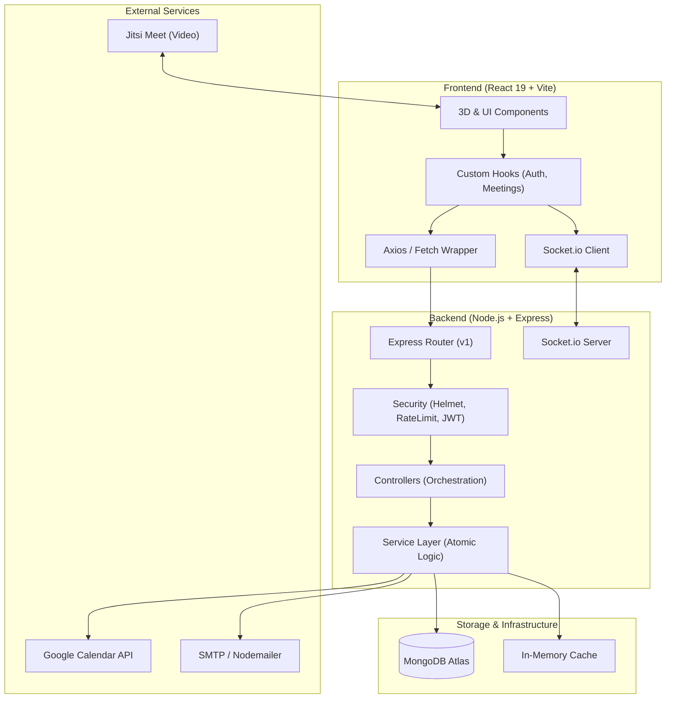

# ⚡ HackHive (Lumina) — Real-Time Meeting Scheduler

> **A full-stack, real-time meeting scheduling and collaboration platform featuring atomic conflict-free booking, interactive 3D visuals, Socket.io state synchronization, automated calendar & email alerts, and integrated video conferencing.**

[](LICENSE)
[](https://react.dev/)
[](https://threejs.org/)
[](https://nodejs.org/)
[](https://socket.io/)
[](https://www.mongodb.com/)

---

## 🌟 Key Highlights

- **🛡️ Atomic Conflict-Free Booking**: Implements MongoDB atomic conditional operations (`findOneAndUpdate({ isBooked: false })`) to eliminate race conditions and double bookings even under high concurrency.
- **🎨 Interactive 3D & Micro-Animated UI**: Built with React 19, Three.js, React Three Fiber, Framer Motion, and GSAP for a responsive, fluid scheduling experience.
- **📡 Real-Time State Sync**: Targeted room-based Socket.io broadcasts (`slot:locked`, `notification`, `dashboard:update`) ensure client states update instantly without manual refreshes.
- **📹 Integrated Video Rooms**: Direct one-click access to Jitsi Meet conferencing for scheduled meetings.
- **📅 Automated Calendar & Notifications**: Google Calendar API synchronization paired with automated email confirmation/reminder delivery via Nodemailer.
- **🔒 Enterprise-Grade Security**: Protected by Helmet security headers, Express Rate Limiting, Mongo Sanitize, HPP parameter pollution protection, and strict JWT validation.

---

## 🏗️ System Architecture



---

## 🛠️ Tech Stack

| Layer | Technologies |
| :--- | :--- |
| **Frontend** | React 19, Vite, React Router v7, Three.js, React Three Fiber, Framer Motion, GSAP, Lucide Icons, Axios, Dayjs |
| **Backend** | Node.js, Express.js, Socket.io, Winston, Swagger UI, Jest |
| **Database & Cache** | MongoDB (Mongoose), Redis (In-Memory Cache) |
| **Security & Auth** | JWT, bcryptjs, Helmet, Express-Rate-Limit, Express-Mongo-Sanitize, HPP |
| **Integrations** | Jitsi Meet, Google Calendar API, Nodemailer |

---

## 📁 Repository Structure

```
.
├── system_architecture.md            # In-depth architectural specification
├── hackhive-meeting-scheduler/
│   ├── backend/                      # Node.js + Express API server
│   │   ├── config/                   # Database, Redis & Socket configs
│   │   ├── controllers/              # Request handlers
│   │   ├── middleware/               # Auth, rate limiting & error handling
│   │   ├── models/                   # Mongoose schemas (User, Meeting, Timeslot, etc.)
│   │   ├── routes/                   # API v1 routes
│   │   ├── services/                 # Atomic booking & business logic
│   │   ├── server.js                 # Server entry point
│   │   └── package.json
│   └── frontend/
│       └── frontend/
│           └── lumina-scheduler/     # React 19 + Three.js client
│               ├── src/              # UI components, canvas & pages
│               ├── package.json
│               └── vite.config.js
└── README.md
```

---

## 🚀 Getting Started

### Prerequisites
- **Node.js**: `v18.x` or higher
- **MongoDB**: Local MongoDB instance or MongoDB Atlas URI

### 1. Clone the Repository
```bash
git clone https://github.com/Vedant-S-Tattimani/meeting-scheduler-.git
cd meeting-scheduler-
```

### 2. Backend Setup
```bash
cd hackhive-meeting-scheduler/backend
npm install
# Copy environment variables template
cp .env.example .env
# Start development server
npm run dev
```
> The backend server runs on `http://localhost:5000` (API documentation available at `/api-docs`).

### 3. Frontend Setup
```bash
cd ../frontend/frontend/lumina-scheduler
npm install
npm run dev
```
> The frontend client runs on `http://localhost:5173`.

---

## 📄 License

Distributed under the MIT License. See `LICENSE` for more information.
